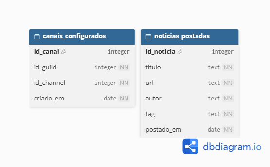

# Discord Bot - Tech Girls

## Objetivo

Desenvolver um bot para a comunidade Tech Girls, integrada ao Discord, que automatize o compartilhamento de notícias de tecnologia por meio da API do TabNews e divulgue vagas na área tech.

## Equipe

Thais
| Maria
| Lucila
| Andressa
  
## Stack

Python 3.14
| discord.py
| SQLite Studio
| API TabNews

## Modelagem do banco de dados

O banco de dados utiliza duas tabelas para armazenar informações relacionadas ao funcionamento do bot: noticias_postadas, que registra as notícias publicadas e canais_configurados, que armazena os identificadores dos servidores e canais do Discord configurados para receber as publicações.

<details>
<summary>Visualizar diagrama do banco de dados</summary>

  

</details>

---

## Como rodar com Docker

### Pré-requisitos

- [Docker](https://docs.docker.com/get-docker/) instalado
- [Docker Compose](https://docs.docker.com/compose/install/) instalado (versão com plugin: `docker compose`)

### 1) Configurar variáveis de ambiente

Na raiz do projeto, crie seu arquivo `.env` a partir do exemplo:

```bash
cp .env.example .env
```

Edite o arquivo `.env` e preencha **todas** as variáveis obrigatórias:

| Variável | Obrigatória para | Descrição |
|---|---|---|
| `GEMINI_API_KEY` | Validação de notícias | Chave da API do Google Gemini |
| `BOT_TOKEN` | Bot Discord completo | Token do bot gerado no Discord Developer Portal |
| `DEV_GUILD_ID` | Opcional | ID do servidor de teste para sincronização imediata dos comandos; sem ele, a sincronização é global |
| `RAPIDAPI_KEY` | Busca de vagas | Chave de autenticação da RapidAPI |
| `RAPIDAPI_HOST` | Busca de vagas | Host da API JSearch (`jsearch.p.rapidapi.com`) |
| `RAPIDAPI_ENDPOINT` | Busca de vagas | Endpoint da API (`/search-v2`) |
| `JSEARCH_QUERY` | Busca de vagas | Query principal (ex: `software engineer`) |
| `JSEARCH_FALLBACK_QUERY` | Busca de vagas | Query fallback (ex: `backend developer`) |
| `JSEARCH_COUNTRY` | Busca de vagas | Código do país (ex: `br`) |
| `JSEARCH_DATE_POSTED` | Busca de vagas | Filtro de data (ex: `all`) |
| `JSEARCH_NUM_PAGES` | Busca de vagas | Número de páginas por requisição (ex: `1`) |

> **Atenção:** `BOT_TOKEN` é necessário para conectar o bot. Sem `DEV_GUILD_ID`, os comandos são sincronizados globalmente e podem demorar para aparecer.

## Como hospedar no Discloud

O arquivo [`discloud.config`](./discloud.config) já define o bot Python, o ponto de entrada (`src/bot.py`), a instalação das dependências e a memória inicial. Para publicar:

1. No painel ou aplicativo da Discloud, crie uma aplicação do tipo **Bot** e envie um ZIP com os arquivos do projeto. O arquivo `discloud.config` deve ficar na raiz do ZIP, junto com `requirements.txt` e a pasta `src`.
2. Configure as variáveis de ambiente do projeto com os valores de `.env.example`. Informe `BOT_TOKEN` para conectar o bot e `GEMINI_API_KEY` para validar notícias; `DEV_GUILD_ID` é opcional e acelera a sincronização dos comandos em um servidor de teste. Se a plataforma não oferecer configuração de variáveis, crie um arquivo `.env` na raiz da aplicação com esses valores.
3. Inicie a aplicação e confira os logs no painel para confirmar que o bot conectou ao Discord.

Não publique o token nem chaves no GitHub. O `.env` deve permanecer fora do repositório; se precisar enviá-lo como arquivo, inclua-o somente no upload privado para a Discloud. O valor inicial de memória é `300 MB` e pode ser ajustado em `discloud.config` conforme o plano e o consumo observado.

## Busca de vagas (RapidAPI + JSearch)

### 1) Como obter a API key da RapidAPI

1. Acesse [RapidAPI](https://rapidapi.com/) e faça login (ou crie uma conta).
2. Abra a API [JSearch](https://rapidapi.com/letscrape-6bRBa3QguO5/api/jsearch).
3. Clique em **Subscribe to Test** e selecione o plano Basic/Free.
4. Abra o Playground no endpoint **GET Job Search**.
5. Copie a chave no header `x-rapidapi-key` do snippet em cURL.
6. Cole a chave na variável `RAPIDAPI_KEY` do seu arquivo `.env`.

### 2) Configuração recomendada no `.env`

```env
RAPIDAPI_HOST=jsearch.p.rapidapi.com
RAPIDAPI_ENDPOINT=/search-v2
JSEARCH_QUERY=software engineer
JSEARCH_FALLBACK_QUERY=backend developer
JSEARCH_COUNTRY=br
JSEARCH_DATE_POSTED=all
JSEARCH_NUM_PAGES=1
```

### 3) Testar a busca via terminal

```bash
set -a && source .env && set +a && \
curl --request GET \
	--url "https://${RAPIDAPI_HOST}${RAPIDAPI_ENDPOINT}?query=software%20engineer&num_pages=${JSEARCH_NUM_PAGES}&country=${JSEARCH_COUNTRY}&date_posted=${JSEARCH_DATE_POSTED}" \
	--header "Content-Type: application/json" \
	--header "x-rapidapi-host: ${RAPIDAPI_HOST}" \
	--header "x-rapidapi-key: ${RAPIDAPI_KEY}"
```

Se estiver correto, a API retorna JSON com `"status":"OK"`.

### 4) Como a busca de vagas funciona no bot

1. O bot executa a task de vagas no cog de jobs.
2. A função de busca faz 1 requisição com `JSEARCH_QUERY`.
3. Se não houver vagas BR válidas, faz no máximo 1 fallback com `JSEARCH_FALLBACK_QUERY`.
4. As vagas novas são enfileiradas e enviadas para os canais configurados.

### 5) Erros comuns

- `404 Endpoint does not exist`: confirme `RAPIDAPI_ENDPOINT=/search-v2`.
- `403 You are not subscribed to this API`: assine a API JSearch na conta da chave usada.
- `429 Too many requests`: limite de plano atingido; reduza frequência de testes.
- Retorno vazio: ajuste as queries (`JSEARCH_QUERY` e `JSEARCH_FALLBACK_QUERY`) para termos simples.

### 6) Consumo de requisições

- Sem fallback: 1 requisição por ciclo de busca.
- Com fallback: até 2 requisições por ciclo de busca.
- Para testes de outras funções, é possível desativar temporariamente a chamada externa na função de busca.

### 2) Build da imagem

```bash
docker compose build
```

### 3) Subir a aplicação

```bash
docker compose up
```

Para rodar em segundo plano:

```bash
docker compose up -d
```

### 4) Ver logs da execução

```bash
docker compose logs -f
```

### 5) Parar os containers

No terminal clique CTRL + C

Em seguida, rode:

```bash
docker compose down
```

## Fluxo executado no container

O container executa o arquivo `src/bot.py`, que realiza em sequência:

1. Carrega as variáveis de ambiente do arquivo `.env`
2. Inicializa as tabelas do banco de dados SQLite (`bot_teste.db`) caso ainda não existam
3. Conecta os "cogs" de tarefas (`tasks`) e configuração de canal (`setup_channel`)
4. Sincroniza os slash commands no servidor de teste configurado em `DEV_GUILD_ID` ou globalmente, se essa variável não estiver definida
5. Mantém o bot online e aguarda os horários programados para buscar e publicar notícias via TabNews + validação Gemini
6. Executa o ciclo de busca de vagas via RapidAPI (JSearch) e envia para os canais configurados


## Dependências

Para rodar o bot e os serviços de busca de notícias, o projeto utiliza as seguintes bibliotecas Python:

* **`discord.py`**: Framework para interação com a API do Discord.
* **`aiohttp`**: Biblioteca assíncrona para requisições HTTP (instalada automaticamente junto com o `discord.py`), utilizada na integração com a API do TabNews.
* **`httpx`**: Biblioteca assíncrona para requisições HTTP utilizada na integração com a API de vagas (RapidAPI/JSearch).
* **`python-dotenv`**: Gerenciamento de variáveis de ambiente (chaves de API, ID do servidor de testes e tokens).

### Para instalar as dependências
No terminal, instale os pacotes necessários:

```bash
pip install discord.py python-dotenv httpx
```
